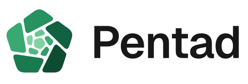
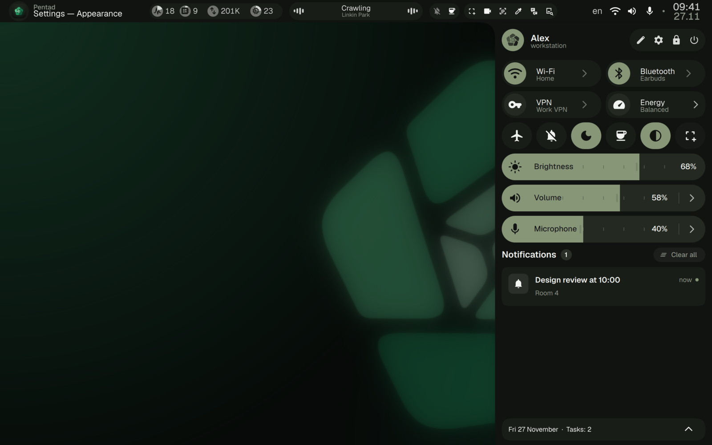
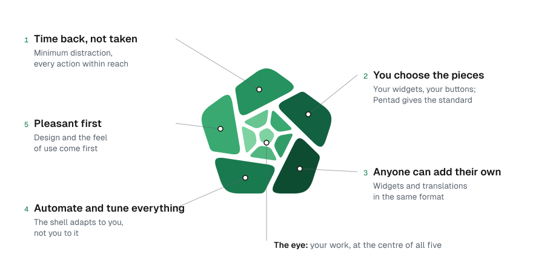
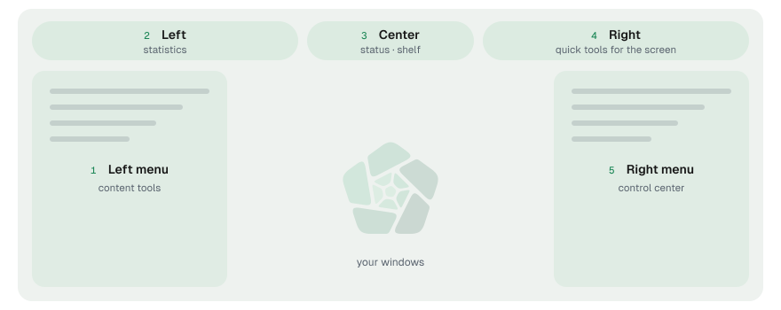
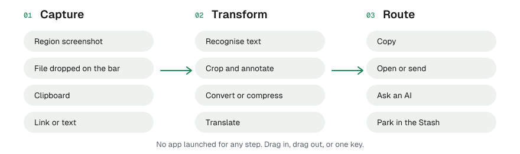
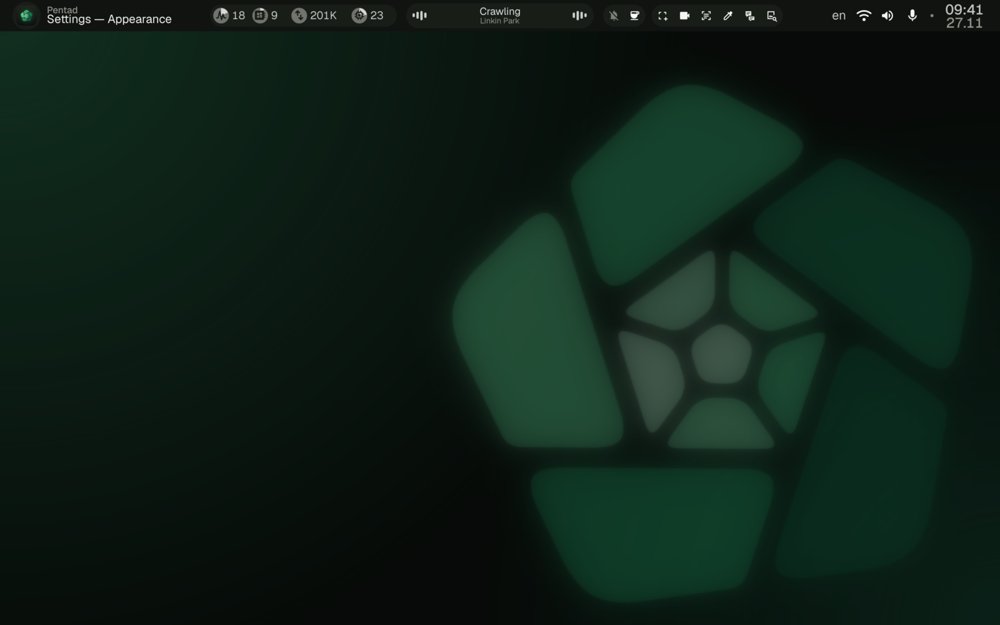
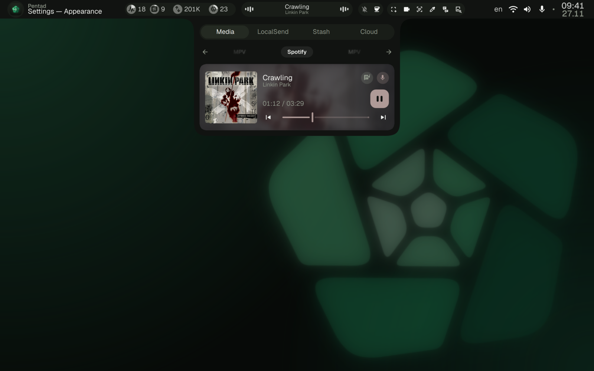
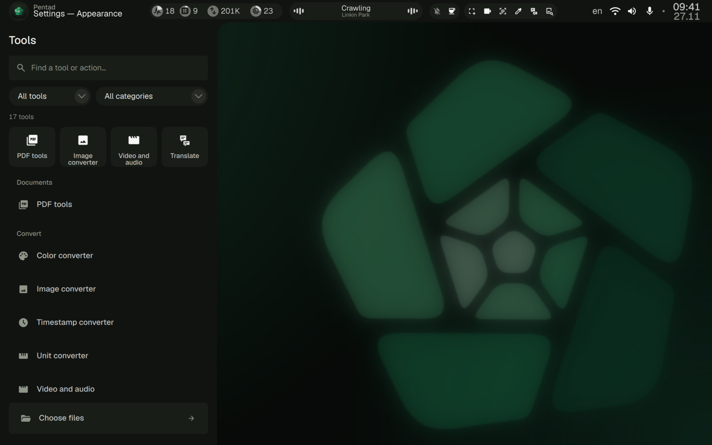
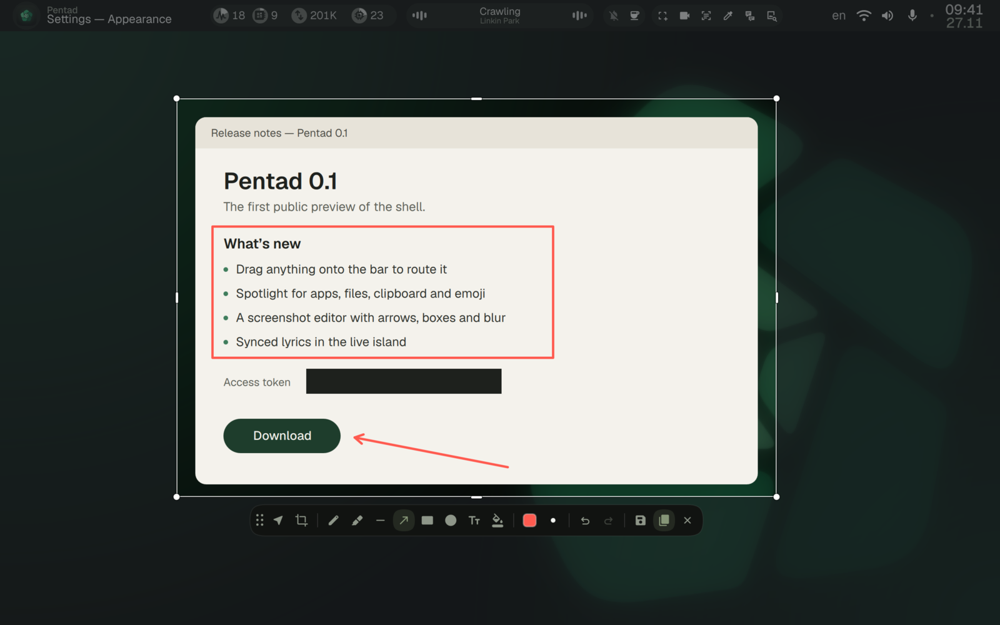
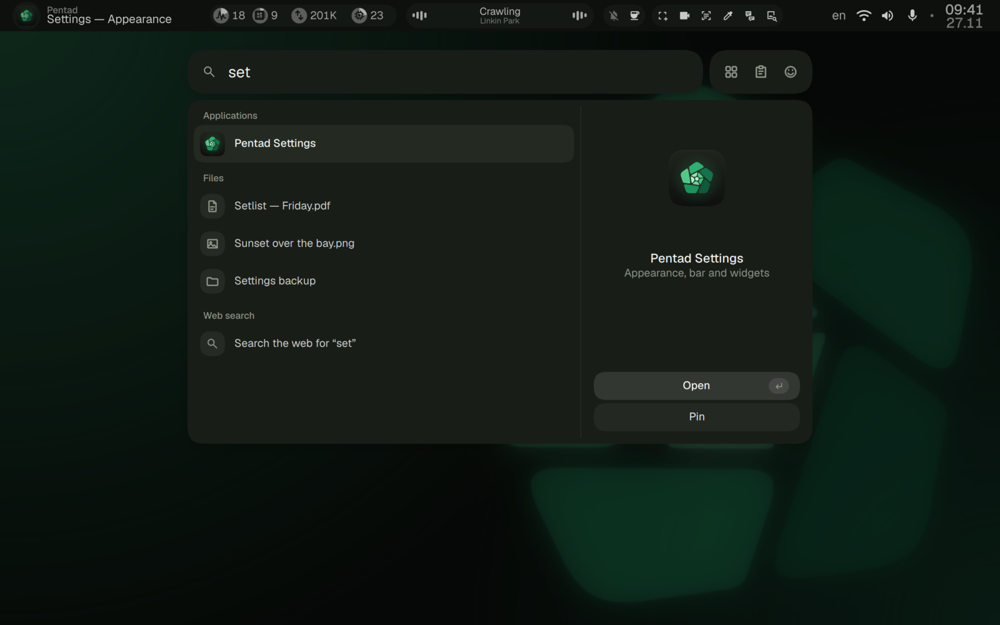

<div align="center">

<h1>
<picture>
<source media="(prefers-color-scheme: dark)" srcset="docs/assets/brand/lockup.svg">

</picture>
</h1>

**The Hyprland shell that gives you time back.**

A universal everyday tool for real work, and for play after it.<br>
You pick the pieces; Pentad keeps them consistent and pleasant to use.

[](LICENSE)
[](https://hypr.land)
[](https://github.com/quickshell-mirror/quickshell)
[](#languages)



[Principles](#five-principles) · [Features](#capture-transform-route) · [Install](#install) · [First steps](#first-steps) · [Widgets](#widgets) · [Contributing](#contributing)

</div>

<h3 align="center">Technology should give us time back, not take it.</h3>

<p align="center">A notification that pulls you out of work, an app you open for a five-second job, a setting that needs a forum thread: each takes a few minutes, many times a day. Pentad is built to hand those minutes back.</p>

Pentad replaces the pieces a bare Hyprland session is missing with one consistent shell: the bar, launcher, control center, notifications, wallpaper, on-screen displays and a screenshot editor. It never changes your Hyprland configuration unless you run `pentad setup` and confirm the changes it shows, and every program it calls is optional, so a missing one only turns off the feature that uses it. Pentad is young (version 0.1); expect changes, especially in the widget API.

## Five principles

<p align="center">
<picture>
<source media="(prefers-color-scheme: dark)" srcset="docs/assets/readme/principles.svg">

</picture>
</p>

1. **Time back, not taken.** Minimum distraction. Nothing calls for you while you work; when you reach for the shell, every action is a keystroke or a drag away.
2. **You choose the pieces.** You decide which widgets and buttons you use and where they go. Pentad gives only the design standard that makes them fit together.
3. **Anyone can add their own.** Your widgets use the same manifest as the built-in ones, and a translation into your language is welcome next to English and Ukrainian.
4. **Automate and tune everything.** As much automation and as many settings as we can offer, so the shell adapts to you, not you to it.
5. **Pleasant first.** The look and the feel of use come first: one shape for one kind of thing, motion that explains, nothing that looks bolted on.

## Why "Pentad"

The shell has five sections, and every widget lives in one of them. The logo is cut the same way: five pieces around a core, and the core is your work.

<p align="center">
<picture>
<source media="(prefers-color-scheme: dark)" srcset="docs/assets/readme/sections.svg">

</picture>
</p>

## Capture, transform, route

Most of a working day is moving something from where it is to where it needs to be, and sometimes changing it on the way: a screenshot into a comment, a clip into an editor, a file to a teammate. Pentad makes that one move.

<p align="center">
<picture>
<source media="(prefers-color-scheme: dark)" srcset="docs/assets/readme/flow.svg">

</picture>
</p>

<table>
<tr>
<td width="50%"><br><b>At rest.</b> Only the bar, nothing asking for attention.</td>
<td width="50%"><br><b>Live island.</b> What is playing, one click from the bar.</td>
</tr>
<tr>
<td><br><b>Tools.</b> PDF, images, video and audio, converters and a translator.</td>
<td><br><b>Screenshots.</b> Capture, annotate, redact, copy or save.</td>
</tr>
<tr>
<td><br><b>Spotlight.</b> Apps, files, a calculator, emoji, clipboard and the web.</td>
<td><br><b>Control center.</b> Quick settings, mixer, calendar and notifications.</td>
</tr>
</table>

<details>
<summary><b>All features</b></summary>

- **Bar.** Statistics on the left, statuses and the shelf in the centre with the live island for what is playing, quick tools for what is on screen, status and the clock on the right. Scroll over its left half for brightness and its right half for volume.
- **Side menus.** Click the left half of the bar for about twenty content tools: PDF, images, text recognition, archives, converters. Click the right half for the control center.
- **Control center.** An editable grid of quick settings (Wi-Fi, Bluetooth, VPN, power profile, do not disturb, night light and more), brightness and volume sliders, a per-app mixer, a calendar with tasks and the notification history.
- **Live island and karaoke.** The current track in the middle of the bar, lyrics synced word by word, an audio visualizer and quick switching between players.
- **Spotlight.** Tap Super for apps, a calculator, offline emoji search in 28 languages, clipboard history and web search.
- **Overview and window switcher.** Super+Tab shows every workspace, and you can drag windows between them. Alt+Tab switches between all windows, Alt+` between the windows of one app.
- **Keybind cheatsheet.** Super+/ shows your Hyprland key bindings as keycaps, grouped by the `Group: text` descriptions in your config, with a search over keys and actions.
- **Notifications.** Pentad's own notification server: popups with actions and inline reply, history grouped by app, do not disturb.
- **Screenshots and screen tools.** Capture a region, window or monitor, then annotate with arrows, shapes, text, highlight and redaction, crop, and copy or save. The bar adds text recognition, a color picker, search by image, translation and area recording.
- **Stash.** A place to park files, links, images, notes and clipboard content: drag them onto the bar or paste them, find them by day or type, and drag them out where you need them. Open it with a shortcut as an overlay or as a normal window.
- **Wallpaper.** A gallery picker with fit modes, per-monitor choices and animated transitions, and it can rotate through your folder on a schedule. Pentad can take its accent color from the wallpaper.
- **Game mode.** A recognized fullscreen game gets its own workspace, and the bar steps aside.
- **Widgets.** 25 built-in widgets use the same manifest format your own widgets use.

</details>

## Install

Pentad needs Hyprland, Quickshell 0.3.2 or newer with the Qt 5 Compatibility and Qt SVG modules, and Python 3. Everything else is optional: a missing program only turns off the feature that uses it.

Choose one way:

- **Arch Linux**, from a clone of this repository: `cd packaging/arch && makepkg -si`. It pulls in the required packages and lists the optional ones.
- **Release tarball**, with no build tools: unpack `pentad-<version>.tar.gz`, enter the directory and run `packaging/install.sh`.
- **From source** on any distribution: run `packaging/install.sh` in a clone. It needs Node.js while installing, but not pnpm.

`packaging/install.sh` installs into `~/.local` without sudo; with `sudo` it installs into `/usr/local`, and `--prefix DIR` picks another place. If `~/.local/bin` is not in your `PATH`, the installer tells you how to add it. On Arch, if something Pentad cannot start without is missing, such as Quickshell, the installer offers to install it with `pacman` and waits for your yes; elsewhere it names what to install.

Then check what Pentad finds on your system:

```console
$ pentad doctor
Pentad doctor

Required
  ok       Pentad files
  ok       Quickshell 0.3.2
  ok       Hyprland
  …
Features
  ok       Screenshots
  missing  Screen recording: needs wf-recorder
  …
```

On Arch it ends with the `pacman` command that installs whatever is missing.

To update, run `pentad stop`, install the new version the same way, then `pentad start`. To remove Pentad, run `packaging/install.sh --uninstall` (with the same prefix) or `sudo pacman -R pentad-git`. Your settings stay in `~/.config/pentad`.

Packagers: see [packaging](packaging/README.md) for the install layout and the full dependency list.

## First steps

1. Start Pentad with Hyprland. In `hyprland.lua`:

   ```lua
   hl.on("hyprland.start", function () hl.exec_cmd("pentad start") end)
   ```

   or in `hyprland.conf`: `exec-once = pentad start`. Pentad shows notifications and draws the wallpaper itself, so other notification and wallpaper daemons (mako, dunst, hyprpaper, swaybg) and any other shell (Waybar, AGS, illogical-impulse, Noctalia and the like) have to leave autostart. `pentad doctor` names what is in the way and where it is started. `pentad setup` makes the switch for you: it shows the exact edits, applies them only after you confirm, rolls them back on its own if Hyprland reports new errors, and `pentad setup --undo` restores everything. Details: [switching to Pentad](docs/development/setup.md).
2. Copy the key bindings you want from `share/pentad/quickshell/defaults/hyprland-quickshell.lua` in the install prefix:

   | Keys | Action |
   | --- | --- |
   | Super (tap) or Super+Space | Spotlight |
   | Super+Tab | Overview |
   | Alt+Tab, Alt+Shift+Tab | Next or previous window |
   | Alt+`, Alt+Shift+` | Next or previous window of the same app |
   | Super+/ | Keybind cheatsheet |

3. Open Settings from the gear in the control center to choose the wallpaper, appearance, language, bar layout, control center tiles and widgets.

Settings are saved as JSON in `~/.config/pentad`, and history such as notifications and Spotlight pins in `~/.local/state/pentad`.

## Languages

The interface ships in English, the main language, and Ukrainian. It follows the system language and can be switched in Settings → Language. Translations into other languages are welcome: open an issue to start one.

## Widgets

Every part of the bar and the side menus is a widget described by a `manifest.json`. Your own widgets go in `~/.config/pentad/plugins/<id>/` and load after a restart:

```json
{
  "id": "example.trim",
  "name": "Trim text",
  "version": "1.0.0",
  "apiVersion": 1,
  "entry": "View.qml",
  "allowedSlots": ["sidebar-left"]
}
```

The [widget API guide](packages/widget-api/v1/README.md) covers the manifest, slots and the services a widget can use, and [widget design](docs/development/widgets.md) the visual rules. The API is experimental and may still change.

## Troubleshooting

- Run `pentad doctor` first.
- `pentad status` and `pentad logs` show whether Pentad runs and what it reports.
- No notifications appear: another notification daemon owns the bus name. Remove it from autostart and restart your session.
- The wallpaper stays hidden: another wallpaper program draws over it.
- To check whether one of your own widgets is at fault, run `pentad restart --safe-mode`. It starts without external widgets and changes no system settings.

Bugs and ideas go to the issue tracker; include the output of `pentad doctor`.

## Contributing

Contributions are welcome; [CONTRIBUTING](CONTRIBUTING.md) explains how, including the sign-off every commit needs. Building and testing need Node.js 24 and pnpm; neither is a runtime dependency. Install the tooling with `pnpm install --frozen-lockfile`, then follow [Quickshell development](docs/development/quickshell.md) for building, running with live reload and the test scenarios. [Controls](docs/development/controls.md) describes the shared UI components.

## References and inspiration

Pentad is an independent project. These designs and projects shaped its look and ideas:

- [Material Design 3](https://m3.material.io) for color roles, shape and motion principles
- [Nothing OS](https://nothing.tech) for its restrained, monochrome visual language
- macOS for the menu bar, Spotlight and overall interaction polish
- [Noctalia](https://docs.noctalia.dev) for declarative extension manifests and settings

A special word about [end-4/dots-hyprland](https://github.com/end-4/dots-hyprland) (illogical-impulse). It was the project that gave me hope that Linux could look truly beautiful. Its shortcomings are what made me decide to build my own shell, and that shell became Pentad. Some ideas, such as window selection in the screenshot tool and the grouped keybind cheatsheet, were inspired by it; no code was copied.

## License

Copyright (C) 2026 maxxxbond and Pentad contributors.

Pentad is free software: you can redistribute it and/or modify it under the terms of the GNU General Public License, version 3 only. It is distributed without any warranty.

See [LICENSE](LICENSE) (GPL-3.0-only). Report vulnerabilities privately as described in [SECURITY](SECURITY.md). Third-party notices are in [LICENSES](LICENSES) and [docs/third-party](docs/third-party). The Pentad name and marks are covered by [TRADEMARK](TRADEMARK.md).
