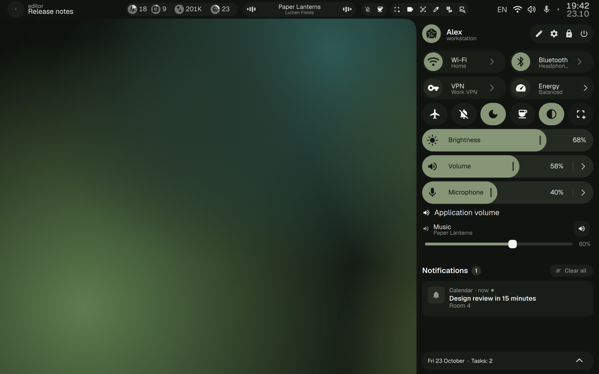

<div align="center">

<h1>
  <picture>
    <source media="(prefers-color-scheme: dark)" srcset="docs/assets/brand/lockup.svg">
    
  </picture>
</h1>

**A calm, complete desktop shell for Hyprland, built on Quickshell.**

[](LICENSE)
[](https://hypr.land)
[](https://github.com/quickshell-mirror/quickshell)
[](#languages)



[Install](#install) · [Features](#features) · [First steps](#first-steps) · [Widgets](#widgets) · [Contributing](#contributing)

</div>

Pentad replaces the pieces a bare Hyprland session is missing with one consistent shell: the bar, launcher, control center, notifications, wallpaper, on-screen displays and a screenshot editor. It is a shell, not a dotfiles bundle: it never changes your Hyprland configuration unless you run `pentad setup` and confirm the changes it shows, and every program it calls is optional, so a missing one only turns off the feature that uses it.

Pentad is young (version 0.1). Expect changes, especially in the widget API.

## The idea

A developer, a researcher, a designer, a gamer and someone editing video all spend the day doing the same small thing: moving a piece of content from where it is to where it needs to be, and sometimes changing it on the way. A screenshot into a comment, a clip into an editor, a file to a teammate, a paper into notes. Pentad makes that one move fast. **Capture** anything by dropping it on the bar or grabbing a region, **transform** it with one of the side-menu tools, and **route** it — open it, copy it, send it, or hand it to an AI — without launching an app for each step.

The point is to give your time back, not spend it. Pentad stays calm and out of the way at rest, with nothing clamouring for attention, and becomes dense on demand: the moment you reach for it, every action is a keystroke or a drag away.

## Features

- **Bar.** Workspaces and system telemetry on the left, a live island for what is playing in the centre, tools, status and the clock on the right. Scroll over its left half for brightness and its right half for volume.
- **Side menus.** Click the left half of the bar for workspaces, weather, chat and about twenty small tools: PDF, images, text recognition, archives, converters. Click the right half for the control center.
- **Control center.** An editable grid of quick settings (Wi-Fi, Bluetooth, VPN, power profile, do not disturb, night light and more), brightness and volume sliders, a per-app mixer, a calendar with tasks and the notification history.
- **Live island and karaoke.** The current track in the middle of the bar, lyrics synced word by word, an audio visualizer and quick switching between players.
- **Spotlight.** Tap Super for apps, a calculator, offline emoji search in 28 languages, clipboard history and web search.
- **Overview and window switcher.** Super+Tab shows every workspace, and you can drag windows between them. Alt+Tab switches between all windows, Alt+` between the windows of one app.
- **Keybind cheatsheet.** Super+/ shows your Hyprland key bindings as keycaps, grouped by the `Group: text` descriptions in your config, with a search over keys and actions.
- **Notifications.** Pentad's own notification server: popups with actions and inline reply, history grouped by app, do not disturb.
- **Screenshots and screen tools.** Capture a region, window or monitor, then annotate with arrows, shapes, text, highlight and redaction, crop, and copy or save. The bar adds text recognition, a color picker, search by image, translation and area recording.
- **Stash.** A place to park files, links, images, notes and clipboard content: drag them onto the bar or paste them, find them by day or type, and drag them out where you need them. Open it with a shortcut as an overlay or as a normal window.
- **Wallpaper.** A gallery picker with fit modes, per-monitor choices and animated transitions, and it can rotate through your folder on a schedule. Pentad can take its accent color from the wallpaper.
- **Game mode.** A recognized fullscreen game gets its own workspace, and the bar steps aside.
- **Widgets.** 25 built-in widgets use the same manifest format your own widgets use.

<p align="center">
  
  <br><sub>The music menu opens from the live island, with lyrics synced to the song.</sub>
</p>

## Install

Pentad needs Hyprland, Quickshell 0.3.2 or newer with the Qt 5 Compatibility and Qt SVG modules, and Python 3. Everything else is optional: a missing program only turns off the feature that uses it.

Choose one way:

- **Arch Linux**, from a clone of this repository: `cd packaging/arch && makepkg -si`. It pulls in the required packages and lists the optional ones.
- **Release tarball**, with no build tools: unpack `pentad-<version>.tar.gz`, enter the directory and run `packaging/install.sh`.
- **From source** on any distribution: run `packaging/install.sh` in a clone. It needs Node.js while installing, but not pnpm.

`packaging/install.sh` installs into `~/.local` without sudo; with `sudo` it installs into `/usr/local`, and `--prefix DIR` picks another place. If `~/.local/bin` is not in your `PATH`, the installer tells you how to add it. On Arch, if something Pentad cannot start without is missing, such as Quickshell, the installer offers to install it with `pacman` and waits for your yes; elsewhere it names what to install.

Then check what Pentad finds on your system:

```console
$ pentad doctor
Pentad doctor

Required
  ok       Pentad files
  ok       Quickshell 0.3.2
  ok       Hyprland
  …
Features
  ok       Screenshots
  missing  Screen recording: needs wf-recorder
  …
```

On Arch it ends with the `pacman` command that installs whatever is missing.

To update, run `pentad stop`, install the new version the same way, then `pentad start`. To remove Pentad, run `packaging/install.sh --uninstall` (with the same prefix) or `sudo pacman -R pentad-git`. Your settings stay in `~/.config/pentad`.

Packagers: see [packaging](packaging/README.md) for the install layout and the full dependency list.

## First steps

1. Start Pentad with Hyprland. In `hyprland.lua`:

   ```lua
   hl.on("hyprland.start", function () hl.exec_cmd("pentad start") end)
   ```

   or in `hyprland.conf`: `exec-once = pentad start`. Pentad shows notifications and draws the wallpaper itself, so remove other notification and wallpaper daemons (mako, dunst, hyprpaper, swaybg) from autostart. If you are switching from another shell (Waybar, AGS, illogical-impulse or any other Quickshell config), its start line has to go too; `pentad doctor` names the processes that hold notifications, the wallpaper or the panels, and lists where they are started. `pentad setup` makes the switch for you, whatever the other shell is (illogical-impulse, Noctalia, DankMaterialShell, Caelestia, HyprPanel, AGS, Waybar, or a notification or wallpaper daemon): it writes Pentad's own `~/.config/hypr/pentad.lua` (or `pentad.conf`) with the start line and key bindings, adds one line to your entry file that loads it (`require("pentad")` through Hyprland's own config path, so a synced dotfiles folder keeps working elsewhere), comments out the other shell's start line when that line is a single plain start statement (`hl.exec_cmd("…")`, the one-line `hl.on("hyprland.start", …)` hook, or `exec-once = …`), masks a systemd user service that runs it, and hides an XDG autostart entry for it; everything else it lists for you to change. It shows the exact edits first and applies them only after you confirm. Then it lets Hyprland check the result: it asks for a config reload (`hyprctl reload`) and reads `hyprctl configerrors`, and if new errors appear it puts everything back on its own. Hyprland reloads on its own as well whenever one of its config files changes, and every reload runs the top-level code of a Lua config again, so a bare `hl.exec_cmd(...)` outside `hl.on("hyprland.start", ...)` runs once more. After a clean apply it offers, as a second question, to switch right now: stop the old shell and start Pentad through Hyprland. `pentad setup --undo` restores the files, unmasks the service and removes the autostart override; when you edited a file after setup, it undoes just its marked lines after showing you the diff.
2. Copy the key bindings you want from `share/pentad/quickshell/defaults/hyprland-quickshell.lua` in the install prefix:

   | Keys | Action |
   | --- | --- |
   | Super (tap) or Super+Space | Spotlight |
   | Super+Tab | Overview |
   | Alt+Tab, Alt+Shift+Tab | Next or previous window |
   | Alt+`, Alt+Shift+` | Next or previous window of the same app |
   | Super+/ | Keybind cheatsheet |

3. Open Settings from the gear in the control center to choose the wallpaper, appearance, language, bar layout, control center tiles and widgets.

Settings are saved as JSON in `~/.config/pentad`, and history such as notifications and Spotlight pins in `~/.local/state/pentad`.

## Languages

The interface is in English and Ukrainian. It follows the system language and can be switched in Settings → Language.

## Widgets

Every part of the bar and the side menus is a widget described by a `manifest.json`. Your own widgets go in `~/.config/pentad/plugins/<id>/` and load after a restart:

```json
{
  "id": "example.trim",
  "name": "Trim text",
  "version": "1.0.0",
  "apiVersion": 1,
  "entry": "View.qml",
  "allowedSlots": ["sidebar-left"]
}
```

The [widget API guide](packages/widget-api/v1/README.md) covers the manifest, slots and the services a widget can use, and [widget design](docs/development/widgets.md) the visual rules. The API is experimental and may still change.

## Troubleshooting

- Run `pentad doctor` first.
- `pentad status` and `pentad logs` show whether Pentad runs and what it reports.
- No notifications appear: another notification daemon owns the bus name. Remove it from autostart and restart your session.
- The wallpaper stays hidden: another wallpaper program draws over it.
- To check whether one of your own widgets is at fault, run `pentad restart --safe-mode`. It starts without external widgets and changes no system settings.

Bugs and ideas go to the issue tracker; include the output of `pentad doctor`.

## Contributing

Contributions are welcome; [CONTRIBUTING](CONTRIBUTING.md) explains how, including the sign-off every commit needs. Building and testing need Node.js 24 and pnpm; neither is a runtime dependency. Install the tooling with `pnpm install --frozen-lockfile`, then follow [Quickshell development](docs/development/quickshell.md) for building, running with live reload and the test scenarios. [Controls](docs/development/controls.md) describes the shared UI components.

## References and inspiration

Pentad is an independent project. These designs and projects shaped its look and ideas:

- [Material Design 3](https://m3.material.io) for color roles, shape and motion principles
- [Nothing OS](https://nothing.tech) for its restrained, monochrome visual language
- macOS for the menu bar, Spotlight and overall interaction polish
- [Noctalia](https://docs.noctalia.dev) for declarative extension manifests and settings

A special word about [end-4/dots-hyprland](https://github.com/end-4/dots-hyprland) (illogical-impulse). It was the project that gave me hope that Linux could look truly beautiful. Its shortcomings are what made me decide to build my own shell, and that shell became Pentad. Some ideas, such as window selection in the screenshot tool and the grouped keybind cheatsheet, were inspired by it; no code was copied.

## License

Copyright (C) 2026 maxxxbond and Pentad contributors.

Pentad is free software: you can redistribute it and/or modify it under the terms of the GNU General Public License, version 3 only. It is distributed without any warranty.

See [LICENSE](LICENSE) (GPL-3.0-only). Report vulnerabilities privately as described in [SECURITY](SECURITY.md). Third-party notices are in [LICENSES](LICENSES) and [docs/third-party](docs/third-party). The Pentad name and marks are covered by [TRADEMARK](TRADEMARK.md).
